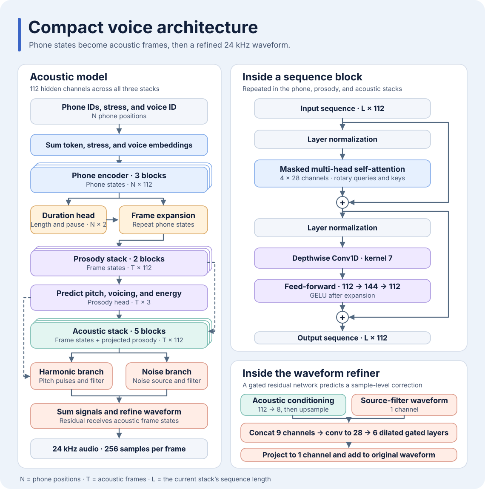

# Compact multilingual browser TTS

This pipeline generates single-voice speech with Maya 2 Native, audits and publishes the corpus, trains a language-specific frontend and compact voice, and exports quantized models for ONNX Runtime Web. The acoustic model reuses the 112-channel source-filter architecture and learned waveform residual from the accepted Bengali checkpoint. It adapts [Tiny Voca](https://github.com/n4ze3m/tiny-voca) by Muhammed Nazeem.

| Bengali reference | Result |
| --- | ---: |
| Inference parameters | 930,224 |
| INT8 model-specific browser download | 997,518 bytes |
| Predicted naturalness | 2.255 UTMOSv2 MOS |
| IndicConformer character error rate | 2.510% |

The model download includes the compressed graph, packed weights, and weight unpacker. The browser engine and text frontend download separately. Bengali's published scores are validation results. UTMOSv2 estimates naturalness. The new language release gate checks predictions on validation and test utterances, with a target of 2.50 and a floor of 2.25, and requires a model-specific browser package below 1 MB.

[Bengali dataset](https://huggingface.co/datasets/Hansda/bengali-maya2-jahnavi-20h) · [Bengali model and card](https://huggingface.co/Hansda/bengali-voice-compact) · [Browser demo](https://tts.hansda.in)

## Model architecture

The compact model uses 112 hidden channels. A duration predictor expands phone states to acoustic frames at a 256-sample hop. Two source-filter branches generate the harmonic and noise components. A learned residual conditioned on acoustic states refines their sum. The diagram uses the stacked-block and residual-path notation of the Transformer paper. [Attention Is All You Need](https://arxiv.org/abs/1706.03762)

[Acoustic model](src/tiny_voca/model.py) · [Waveform refiner](pipeline/wave_refiner.py)

## Browser inference

**Load model** fetches the selected voice. **Play** normalizes the input, converts Romanized text where applicable, and runs the acoustic model in a Web Worker. The browser uses the pronunciation lexicon first and loads the ONNX grapheme-to-phoneme model when it encounters an unfamiliar word.

[Browser worker](web/worker.js) · [Player and WAV encoding](web/app.js)

## Run the pipeline

Use Python 3.12, an NVIDIA CUDA build of PyTorch for training, CTranslate2 with compatible CUDA/cuDNN for GPU ASR, and `libespeak-ng.so.1` for making G2P supervision. Install the packages in `requirements.txt` and [UTMOSv2](https://github.com/sarulab-speech/UTMOSv2) in the scoring environment. For the static-site check, install Google Chrome and Playwright. Maya runs in its own environment using the publisher's [inference setup](https://github.com/MayaResearch/maya2-native/tree/c6b376868e268551d065c4206193e96257bef4a1). Its checked weights revision is `87a83efdd6551e038246b6b37836a6264713eec3`. Check `source.json` for the pinned source details emitted for every generated language.

1. `python prompts.py artifacts/prompts hi en ml te gu` downloads text-only prompt files, validates their Unicode script, and writes distinct prompts, exact input hashes, and license provenance.
2. `MAYA_PYTHON=/path/to/python MAYA_ENGINE=/path/to/maya2-native MAYA_MODELS=/path/to/models bash run_synthesis.sh` generates the recordings using one named voice per language. The models directory contains `maya2-native`, `mimi` and `ecapa`. The generator reserves extra audio for independent audit rejection and resumes from SQLite after interruption.
3. `python get_indic_asr.py artifacts/indic-asr hi` stages the pinned IndicConformer model. `python audit.py artifacts/generated/hi artifacts/audit/hi-ctc.jsonl --language hi --device cuda --indic-models artifacts/indic-asr --release artifacts/releases/hi` obtains independent word timings and finalizes the first 20 verified hours. English uses Whisper large-v3. `publish_dataset.py` validates per-clip WAV and PCM checksums and packages the deterministic train, validation, and test splits as Audio Parquet. Pass `--repo OWNER/DATASET` after signing in using `hf auth login` to publish.
4. Place `bengali-2.255-fp32.pt` and the Bengali `frontend/phone-vocab.json` from the published model under `artifacts/bn-model/`. Set `PYTHONPATH=.:src:pipeline`. Run `pipeline/g2p_training.py` on the released language manifest and `pipeline/prepare_language.py` to build its matched phone durations, pitch, and mel features. The tokenizer has 512 IDs. The learned phonemizer uses eSpeak NG seed pronunciations and runs independently of eSpeak in the browser.
5. Run `pipeline/train_compact.py` with the aligned data, generated frontend, Bengali reference, and Bengali vocabulary. The script trains all acoustic parameters, including the waveform generator, by default. Pass `--init` for the second perceptual training phase and `--refiner-only` for the last residual phase. It writes full training state to `resume.pt` and preserves periodic FP32 model checkpoints and final INT8 and INT4 archives. `pipeline/repack.py` also produces a calibrated 6-bit candidate while preserving selected sensitive tensors at 8 bits.
6. `pipeline/export_voice.py` produces compact graphs, packed weights, and G2P assets. `pipeline/score_voice.py` measures validation or test naturalness, using 24 prompts and the three Bengali crop seeds. `pipeline/score_intelligibility.py` estimates CER from independent transcripts. The differing ASR and language prompt sets must be disclosed when comparing CER with Bengali.
7. `pipeline/publish_voice.py` verifies quantized candidates against the model byte cap and quality floor before uploading. The model card cites the exact released corpus and reports the selected variant metrics. `prepare_site.py` takes the prior Bengali static assets and adds qualified language variants. Once a language finishes training, the site timer can deploy its highest-scoring sub-1 MB browser candidate as a preview. `site-previews.json` pins specific previews. `check_site.py` verifies mobile layout, single-model lazy downloads, and local audio playback.

`release-languages.txt` lists the active new languages in queue order. Production queues and user service files are under `services/`, `run_synthesis.sh`, `release_queue.sh`, `train_queue.sh`, and `deploy_site.sh`. Local path defaults in the service files match the original workstation. Review those paths, the Hugging Face namespace, and your authorized deployment destination before installing them elsewhere. The queues use a shared GPU lock for generation and audit and an exclusive lock for training. GPU jobs, dataset uploads, and the static site can resume independently.

## Roman-script converter

`converter/build.py` builds lexicons for Gujarati, Hindi, Malayalam, and Telugu using the published [Dakshina train lexicons](https://github.com/google-research-datasets/dakshina) and native word and context frequencies from the prompt manifests. Rule-based script spelling handles words absent from the lookup. The existing Bengali converter is used for Bengali. English uses its standard Latin script.

`converter/fixtures/` contains 100 distinct everyday Roman/native inputs per language. Each input joins an everyday opener and a separate request or observation. The author-written references have been checked for uniqueness, with native-speaker review pending. `converter/score.mjs` reports normalized exact match and character error rate. Roman-to-native CER measures spelling agreement. It does not measure acoustic pronunciation or naturalness.

## Sources and licenses

The model and adapted Tiny Voca code use Apache 2.0. Text sources have separate licenses. The released datasets identify Common Voice, AI4Bharat Rasa, and when used OpenSLR sources and include their applicable CC0, CC BY 4.0, or CC BY-SA 4.0 terms. Maya 2 Native uses its Apache 2.0 release with the CC BY 4.0 Kyutai Mimi codec. Adapted Dakshina lexicon assets retain CC BY-SA 4.0. The Bengali frontend credits the CC BY 4.0 Google Bengali pronunciation lexicon in the model repository.
