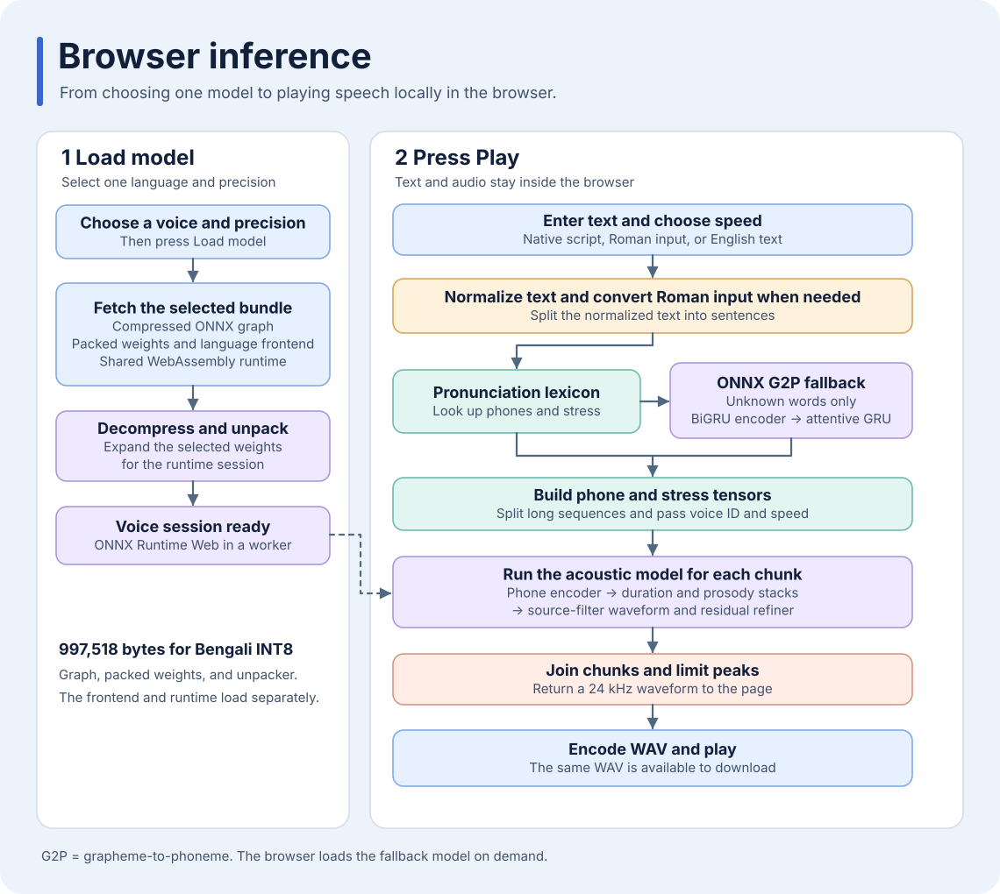

# Compact multilingual browser TTS

[Try it at **tts.hansda.in**](https://tts.hansda.in). Choose a language and checkpoint, select **Load model**, then press **Play**. The demo downloads the selected voice on demand and generates speech in your browser. Indic voices accept native script and Roman input.

## Datasets and models

Each dataset contains 20 hours of single-voice synthetic speech. The model cards list the checkpoints, browser package sizes, and evaluation results.

| Language | Hugging Face dataset | Hugging Face model |
| --- | --- | --- |
| Bengali | [Jahnavi dataset](https://huggingface.co/datasets/Hansda/bengali-maya2-jahnavi-20h) | [Compact INT8 model](https://huggingface.co/Hansda/bengali-voice-compact) |
| Gujarati | [Jahnavi dataset](https://huggingface.co/datasets/Hansda/gujarati-maya2-jahnavi-20h) | [Compact INT6 model](https://huggingface.co/Hansda/gujarati-voice-compact) |
| Hindi | [Ishwari dataset](https://huggingface.co/datasets/Hansda/hindi-maya2-ishwari-20h) | [Compact INT6 and INT7 models](https://huggingface.co/Hansda/hindi-voice-compact) |
| Malayalam | [Jahnavi dataset](https://huggingface.co/datasets/Hansda/malayalam-maya2-jahnavi-20h) | [Compact INT6 model](https://huggingface.co/Hansda/malayalam-voice-compact) |
| Telugu | [Sreekar dataset](https://huggingface.co/datasets/Hansda/telugu-maya2-sreekar-20h) | [Browser preview](https://tts.hansda.in/?lang=te) |
| English | [Nivedita dataset](https://huggingface.co/datasets/Hansda/english-maya2-nivedita-20h) | [Compact INT6 model](https://huggingface.co/Hansda/english-voice-compact) |

## Run the pipeline

Use Python 3.12 and install [the dependencies](requirements.txt). Training uses CUDA PyTorch, pronunciation supervision uses `libespeak-ng.so.1`, and scoring uses [UTMOSv2](https://github.com/sarulab-speech/UTMOSv2).

1. **Generate speech.** Run `python prompts.py artifacts/prompts hi en ml te gu`. Set `MAYA_PYTHON`, `MAYA_ENGINE`, and `MAYA_MODELS` for the [Maya 2 Native inference setup](https://github.com/MayaResearch/maya2-native/tree/c6b376868e268551d065c4206193e96257bef4a1), then run [`run_synthesis.sh`](run_synthesis.sh).
2. **Audit and package.** Use [`audit.py`](audit.py) to check transcripts and keep 20 usable hours. Use [`publish_dataset.py`](publish_dataset.py) to build the train, validation, and test Parquet shards. Authenticate with `hf auth login` before publishing.
3. **Train and export.** Set `PYTHONPATH=.:src:pipeline`. Fetch `bengali-2.255-fp32.pt` and `frontend/phone-vocab.json` from the Bengali model card into `artifacts/bn-model/`. [`train_queue.sh`](train_queue.sh) shows the commands for phonemizer training, acoustic alignment, the three training stages, quantization, and scoring. Checkpoints save training state for resume.
4. **Test the browser build.** Copy `browser/` from the Bengali model into `artifacts/bn-model/`. Build the Roman-input lexicons with [`converter/build.py`](converter/build.py). Run `python prepare_site.py PATH_TO_BENGALI_BROWSER_DIST artifacts/site`, then `python check_site.py artifacts/site` with Chrome and Playwright installed. `PATH_TO_BENGALI_BROWSER_DIST` points to a base build from [`pipeline/build_bengali_web.py`](pipeline/build_bengali_web.py).

The queue scripts and [service units](services/) reference the original workstation and deployment. Review their paths and destinations before running them on another machine.

Model architecture and browser inference

### Model architecture

[Acoustic model](src/tiny_voca/model.py) · [Waveform refiner](pipeline/wave_refiner.py)

### Browser inference

[Browser worker](web/worker.js) · [Roman input converter and validation fixtures](converter/)

## Credits

The acoustic model adapts [Tiny Voca by Muhammed Nazeem](https://github.com/n4ze3m/tiny-voca). [Maya 2 Native](https://huggingface.co/maya-research/maya2-native) generated the training audio. The dataset cards document prompt sources and licenses. [Full demo credits](https://tts.hansda.in/credits.html)
